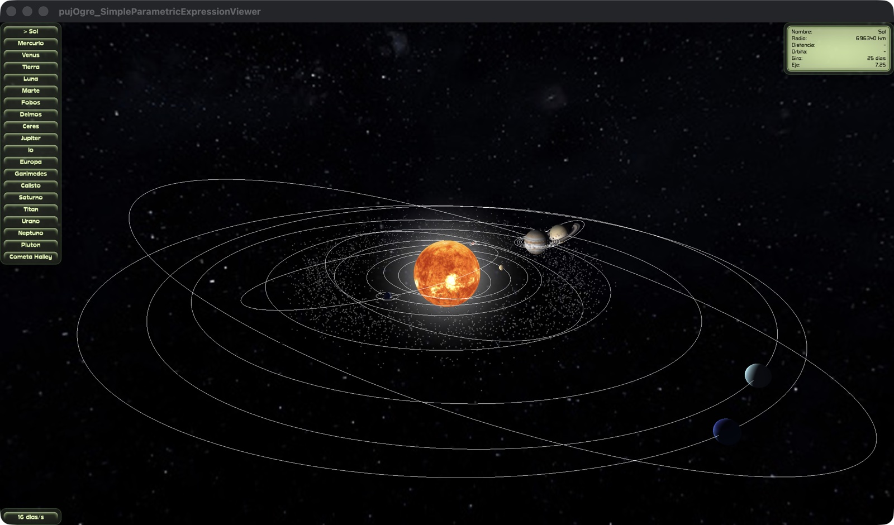

# Sistema Solar en OGRE

Simulación 3D interactiva del Sistema Solar en C++ con [OGRE 14](https://www.ogre3d.org/). Los cuerpos siguen órbitas elípticas calculadas con las leyes de Kepler, a partir de sus elementos orbitales reales, con iluminación, sombras y atmósferas hechas con shaders GLSL propios.



## Características

- **Órbitas de Kepler:** 8 planetas, 2 planetas enanos, 8 lunas y el cometa Halley, con periodos, excentricidades e inclinaciones reales (el Halley es la excepción, ver [Qué es real](#qué-es-real-y-qué-no)).
- **Rotación y ejes:** cada planeta gira con su periodo real sobre su eje inclinado. Venus y Urano giran al revés.
- **Iluminación:** luz puntual desde el Sol con modelo difuso de Lambert, con lado de día y de noche.
- **Eclipses:** de Luna y de Sol, con frecuencia realista, más las sombras entre Saturno y sus anillos.
- **Tierra detallada:** luces de ciudades en el lado de noche y una capa de nubes en movimiento.
- **Atmósferas:** borde luminoso en los cuerpos que tienen atmósfera.
- **Cinturón de asteroides:** 3000 rocas, cada una con su propia órbita.
- **Cámara:** selección de cualquier cuerpo, vuelo suave hasta él y seguimiento mientras se mueve.
- **Control del tiempo:** de 0.0625 a 16384 días simulados por segundo.
- **Datos en pantalla:** radio, distancia, periodos e inclinación del cuerpo seleccionado.

## Controles

| Control | Acción |
|---|---|
| `↓` `→` / `↑` `←` | Cuerpo siguiente / anterior |
| Arrastrar con botón izquierdo | Orbitar alrededor del cuerpo seleccionado |
| Rueda del mouse | Acercar o alejar |
| `+` / `-` | Duplicar o reducir a la mitad la velocidad del tiempo |
| `Espacio` | Pausar o continuar |
| `E` | Saltar al siguiente eclipse de Luna |
| `S` | Saltar al siguiente eclipse de Sol |
| `Esc` | Salir |

## Qué es real y qué no

Una escala completamente real no se podría ver: a la escala de este modelo, Neptuno estaría a cientos de miles de unidades del Sol. Por eso:

| Real | Comprimido o aproximado |
|---|---|
| Periodos orbitales y de rotación | Tamaños y distancias: solo se conserva su orden |
| Excentricidades, inclinaciones y ejes | Excentricidad del Halley: 0.85 en vez de 0.967, para que no salga de la vista |
| Posiciones aproximadas de enero de 2000 | Texturas de Plutón, el Halley y 7 lunas: la de la Luna, teñida |
| Ángulos de los eclipses | Asteroides: mucho más grandes de lo real, para que se vean |

**Limitaciones conocidas:**

- Las órbitas no tienen perturbaciones entre planetas ni la precesión de 18.6 años de la órbita lunar, así que los eclipses siempre caen en las mismas épocas del año.
- Por la compresión, Plutón llega hasta la órbita de Urano; en la realidad solo cruza la de Neptuno.
- Las lunas de Júpiter no proyectan sombra.

## Cómo funciona

**Posición en la órbita.** En cada frame se resuelve la ecuación de Kepler con el método de Newton y se aplican los elementos orbitales. Las lunas orbitan relativas a su planeta, porque en la escena son hijas de su nodo.

```
M = M₀ + 2π · t / T          anomalía media
M = E − e · sin(E)           ecuación de Kepler
```

**Precisión del tiempo.** Los ángulos y el tiempo se guardan en `double` y la orientación se recalcula desde el total. Sumar giros diminutos cada frame a un cuaternión `float` acumularía error a velocidades bajas.

**Iluminación.** `scenes/planet.frag` calcula `color = textura × (ambiente + max(0, N · L) × sombra)`, más las luces nocturnas y el borde de la atmósfera, que se activan según el material.

**Eclipses.** Se calculan con ángulos, que no cambian al comprimir las distancias. Comparar la dirección de la Luna con el eje Sol-Tierra, usando los tamaños angulares reales de la sombra, da una frecuencia realista aunque las distancias del modelo no lo sean.

**Geometría.** Las esferas y los anillos son superficies paramétricas definidas con expresiones en la escena, y VTK las convierte en mallas de OGRE.

## Estructura

```
apps/SimpleParametricExpressionViewer/   Aplicación: simulación, cámara e interfaz
lib/pujOgre/                             Conversión de superficies VTK a mallas de OGRE
plugins/DotPPScene/                      Cargador de escenas .scenepp
plugins/VTKCodec/                        Códec de archivos VTK para OGRE
scenes/solar_system.scenepp              Cuerpos, órbitas y propiedades
scenes/SolarSystem.material              Materiales y programas de shaders
scenes/planet.vert, planet.frag          Shaders de planetas, lunas y nubes
scenes/ring.frag                         Shader de los anillos de Saturno
```

Tamaños, órbitas y velocidades se pueden cambiar en `scenes/solar_system.scenepp`, sin recompilar. Las propiedades están explicadas al inicio de ese archivo.

## Compilar y ejecutar

Probado únicamente en macOS con Apple Silicon. En otros sistemas puede requerir ajustes.

**Requisitos:** CMake 3.20 o superior, un compilador con C++23 y Git. En macOS, además, las herramientas de línea de comandos de Xcode.

### 1. Dependencias

OGRE 14.6, VTK 9.7 y SDL 2.32 se compilan en una carpeta local, sin instalar nada en el sistema. Puede tardar varios minutos.

```bash
# Desde la carpeta que contiene este repositorio
mkdir ogre-sdk && cd ogre-sdk
SDK=$PWD

# SDL2: en macOS, OGRE lo necesita para crear la ventana
curl -fsSL https://libsdl.org/release/SDL2-2.32.10.tar.gz | tar xz
cmake -S SDL2-2.32.10 -B sdl2-build -DCMAKE_BUILD_TYPE=Release \
  -DCMAKE_INSTALL_PREFIX=$SDK/sdl2 -DSDL_STATIC=OFF
cmake --build sdl2-build -j8 && cmake --install sdl2-build

# OGRE
git clone --depth 1 -b v14.6.3 https://github.com/OGRECave/ogre.git ogre-src
cmake -S ogre-src -B ogre-build -DCMAKE_BUILD_TYPE=Release \
  -DCMAKE_INSTALL_PREFIX=$SDK/ogre -DSDL2_DIR=$SDK/sdl2/lib/cmake/SDL2 \
  -DOGRE_BUILD_LIBS_AS_FRAMEWORKS=OFF -DOGRE_BUILD_DEPENDENCIES=ON \
  -DOGRE_BUILD_SAMPLES=OFF -DOGRE_BUILD_TESTS=OFF -DOGRE_BUILD_TOOLS=OFF \
  -DOGRE_BUILD_COMPONENT_PYTHON=OFF -DOGRE_BUILD_COMPONENT_JAVA=OFF \
  -DOGRE_BUILD_COMPONENT_CSHARP=OFF -DOGRE_BUILD_RENDERSYSTEM_GL=OFF \
  -DOGRE_BUILD_RENDERSYSTEM_GL3PLUS=ON -DOGRE_BUILD_RENDERSYSTEM_METAL=OFF \
  -DOGRE_INSTALL_SAMPLES=OFF -DOGRE_INSTALL_TOOLS=OFF -DOGRE_INSTALL_DOCS=OFF
cmake --build ogre-build -j8 && cmake --install ogre-build

# VTK: solo los módulos necesarios
git clone --depth 1 -b v9.7.2 https://github.com/Kitware/VTK.git vtk-src
cmake -S vtk-src -B vtk-build -DCMAKE_BUILD_TYPE=Release \
  -DCMAKE_INSTALL_PREFIX=$SDK/vtk -DBUILD_SHARED_LIBS=ON \
  -DVTK_BUILD_TESTING=OFF -DVTK_BUILD_EXAMPLES=OFF -DVTK_WRAP_PYTHON=OFF \
  -DVTK_GROUP_ENABLE_Imaging=DONT_WANT -DVTK_GROUP_ENABLE_MPI=DONT_WANT \
  -DVTK_GROUP_ENABLE_Qt=DONT_WANT -DVTK_GROUP_ENABLE_Rendering=DONT_WANT \
  -DVTK_GROUP_ENABLE_StandAlone=DONT_WANT -DVTK_GROUP_ENABLE_Views=DONT_WANT \
  -DVTK_GROUP_ENABLE_Web=DONT_WANT -DVTK_MODULE_ENABLE_VTK_CommonCore=YES \
  -DVTK_MODULE_ENABLE_VTK_CommonDataModel=YES \
  -DVTK_MODULE_ENABLE_VTK_CommonComputationalGeometry=YES \
  -DVTK_MODULE_ENABLE_VTK_CommonMisc=YES -DVTK_MODULE_ENABLE_VTK_FiltersCore=YES \
  -DVTK_MODULE_ENABLE_VTK_FiltersSources=YES -DVTK_MODULE_ENABLE_VTK_IOLegacy=YES \
  -DVTK_MODULE_ENABLE_VTK_IOXML=YES
cmake --build vtk-build -j8 && cmake --install vtk-build
```

### 2. Compilar

```bash
# Desde la carpeta de este repositorio, con la variable SDK del paso anterior
cmake -S . -B build -DCMAKE_BUILD_TYPE=Release \
  -DOGRE_DIR=$SDK/ogre/CMake \
  -DVTK_DIR=$SDK/vtk/lib/cmake/vtk-9.7 \
  -DSDL2_DIR=$SDK/sdl2/lib/cmake/SDL2 \
  -DCMAKE_SHARED_LINKER_FLAGS="-L$SDK/ogre/lib"
cmake --build build -j8
```

### 3. Ejecutar

```bash
OGRE_CONFIG_DIR=$SDK/ogre/bin DYLD_LIBRARY_PATH=$SDK/sdl2/lib \
  ./build/pujOgre_SimpleParametricExpressionViewer scenes/solar_system.scenepp
```

La primera vez, OGRE muestra un diálogo de configuración: elige *OpenGL 3+ Rendering Subsystem* y pulsa **OK**.

## Créditos

- **Base del proyecto:** [pujOgre](https://github.com/florez-l/pujOgre), de Leonardo Flórez-Valencia, de quien son el cargador de escenas, las superficies paramétricas y la estructura del visor.
- **Texturas:** [Solar System Scope](https://www.solarsystemscope.com/textures/), bajo licencia [CC BY 4.0](https://creativecommons.org/licenses/by/4.0/). La textura de Ceres es una recreación artística del propio sitio.
- **Motores y bibliotecas:** [OGRE](https://www.ogre3d.org/), [VTK](https://vtk.org/), [SDL](https://www.libsdl.org/) y [pugixml](https://pugixml.org/).

## Licencia

Este repositorio no tiene licencia de código, porque parte de `pujOgre`, que no declara ninguna. Las texturas conservan su licencia CC BY 4.0.
